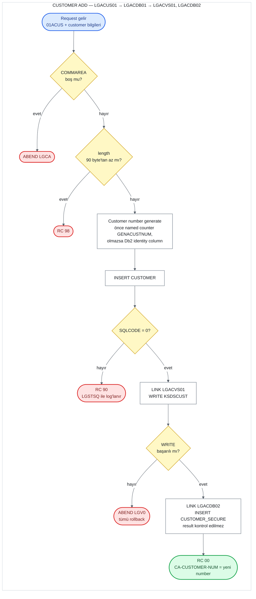

# UC-01 · Customer Add

Yeni bir customer'ı Db2'deki `CUSTOMER` table'ına, password'ünü `CUSTOMER_SECURE`
table'ına ve record'unu `KSDSCUST` VSAM dosyasına yazan operasyon. Bu belge, C# kodunu
yazacak kişi için eski sistemin davranışını satır satır tarif eder. Satır numaraları
`base/src` altındaki dosyalara aittir ve linkler ilgili satırı açar.

## Özet

| | |
|---|---|
| **Request ID** (`CA-REQUEST-ID`) | `01ACUS` — screen bunu gönderir ama call chain'deki hiçbir program kontrol etmez |
| **Entry program** | `LGACUS01` (business layer) |
| **Call chain** | `LGACUS01` → `LGACDB01` → `LGACVS01`, ardından `LGACDB02` |
| **Yazıldığı yerler** | Db2 `CUSTOMER` table, Db2 `CUSTOMER_SECURE` table, VSAM `KSDSCUST` |
| **Output** | Yeni customer number `CA-CUSTOMER-NUM`'da, `CA-RETURN-CODE = '00'` |
| **Olası return code'lar** | `00`, `90`, `98` (ve ABEND `LGCA`, `LGV0`) |

## Flow

## Input (COMMAREA)

Screen (`LGTESTC1`, menu 2) aşağıdaki field'ları doldurup `LGACUS01`'i call eder
([lgtestc1.cbl:113-131](../../base/src/lgtestc1.cbl#L113-L131)). Field tanımları
[lgcmarea.cpy](../../base/src/lgcmarea.cpy) içinde.

| Field | Type | Gelen value | Kullanım |
|---|---|---|---|
| `CA-REQUEST-ID` | `X(6)` | `'01ACUS'` | Kontrol edilmiyor |
| `CA-CUSTOMER-NUM` | `9(10)` | `0` | Yok sayılıyor; yeni number bunun üzerine yazılır |
| `CA-FIRST-NAME` | `X(10)` | screen'den | `CUSTOMER.FIRSTNAME` |
| `CA-LAST-NAME` | `X(20)` | screen'den | `CUSTOMER.LASTNAME` |
| `CA-DOB` | `X(10)` | screen'den | `CUSTOMER.DATEOFBIRTH` (Db2'de `DATE` type) |
| `CA-HOUSE-NAME` | `X(20)` | screen'den | `CUSTOMER.HOUSENAME` |
| `CA-HOUSE-NUM` | `X(4)` | screen'den | `CUSTOMER.HOUSENUMBER` |
| `CA-POSTCODE` | `X(8)` | screen'den, **uppercase'e çevrilmiş** | `CUSTOMER.POSTCODE` |
| `CA-PHONE-MOBILE` | `X(20)` | screen'den | `CUSTOMER.PHONEMOBILE` |
| `CA-PHONE-HOME` | `X(20)` | screen'den | `CUSTOMER.PHONEHOME` |
| `CA-EMAIL-ADDRESS` | `X(100)` | screen'den | `CUSTOMER.EMAILADDRESS` |

Screen iki hazırlık daha yapar ([lgtestc1.cbl:125-127](../../base/src/lgtestc1.cbl#L125-L127)):
COMMAREA'daki `X'00'` (low-value) byte'larını space'e çevirir ve postcode'u uppercase'e
çevirir. Bunlar business layer'da değil screen'de yapıldığı için C# tarafında input
validation'ın parçası olarak ele alınmalı.

## Adım adım

| # | Program | Ne yapıyor | Kaynak |
|---:|---|---|---|
| 1 | `LGACUS01` | COMMAREA hiç gelmediyse (`EIBCALEN = 0`) error log'a yazar ve `LGCA` koduyla ABEND eder. | [lgacus01.cbl:95-99](../../base/src/lgacus01.cbl#L95-L99) |
| 2 | `LGACUS01` | `CA-RETURN-CODE = '00'`, `CA-NUM-POLICIES = 000` yapar. | [lgacus01.cbl:102-103](../../base/src/lgacus01.cbl#L102-L103) |
| 3 | `LGACUS01` | Gereken minimum length = header 18 + `WS-CUSTOMER-LEN` 72 = **90 byte**. Daha kısaysa `'98'` ile return eder. | [lgacus01.cbl:108-115](../../base/src/lgacus01.cbl#L108-L115), [lgpolicy.cpy:17](../../base/src/lgpolicy.cpy#L17) |
| 4 | `LGACUS01` | `LGACDB01`'i aynı COMMAREA ile `LINK` eder (32.500 byte). Return'de hiçbir şeyi kontrol etmez, doğrudan caller'a return eder. | [lgacus01.cbl:119-123](../../base/src/lgacus01.cbl#L119-L123), [134-137](../../base/src/lgacus01.cbl#L134-L137) |
| 5 | `LGACDB01` | 1-3. adımdaki kontrollerin aynısını tekrarlar (ABEND `LGCA`, `'00'`, 90 byte → `'98'`). | [lgacdb01.cbl:149-168](../../base/src/lgacdb01.cbl#L149-L168) |
| 6 | `LGACDB01` | Customer number'ı generate eder (aşağıdaki bölüm). | [lgacdb01.cbl:199-211](../../base/src/lgacdb01.cbl#L199-L211) |
| 7 | `LGACDB01` | `CUSTOMER` table'ına `INSERT` yapar. Error olursa `'90'`, error log ve hemen return; 8-10. adımlar çalışmaz. | [lgacdb01.cbl:215-283](../../base/src/lgacdb01.cbl#L215-L283) |
| 8 | `LGACDB01` | Generate edilen number'ı `CA-CUSTOMER-NUM`'a yazar. | [lgacdb01.cbl:285](../../base/src/lgacdb01.cbl#L285) |
| 9 | `LGACDB01` → `LGACVS01` | COMMAREA'yı `LENGTH(225)` ile `LGACVS01`'e verir; o da `KSDSCUST`'e record'u yazar. Başarısızsa `'80'` yazar ve `LGV0` ile ABEND eder. | [lgacdb01.cbl:174-177](../../base/src/lgacdb01.cbl#L174-L177), [lgacvs01.cbl:68-81](../../base/src/lgacvs01.cbl#L68-L81) |
| 10 | `LGACDB01` → `LGACDB02` | **Ayrı bir COMMAREA** (`CDB2AREA`) hazırlar: request ID `'02ACUS'`, yeni number, sabit password hash, counter `'0000'`, state `'N'`. `LGACDB02`'yi call eder; o da `CUSTOMER_SECURE`'a `INSERT` yapar. | [lgacdb01.cbl:179-189](../../base/src/lgacdb01.cbl#L179-L189), [lgacdb02.cbl:143-182](../../base/src/lgacdb02.cbl#L143-L182) |
| 11 | `LGACDB01` | Caller'a return eder. `CA-RETURN-CODE` hâlâ `'00'`. | [lgacdb01.cbl:192](../../base/src/lgacdb01.cbl#L192) |

## Customer number nasıl generate edilir

`LGACDB01`'in `Obtain-CUSTOMER-Number` paragrafı
([lgacdb01.cbl:199-211](../../base/src/lgacdb01.cbl#L199-L211)) iki yoldan birini seçer.
Hangi yolun kullanılacağını `LGAC-NCS` flag'i belirler; value'su her call'da `'ON'` ile
başlar ([lgacdb01.cbl:73](../../base/src/lgacdb01.cbl#L73)).

**1. yol — CICS named counter:**
`EXEC CICS GET COUNTER(GENACUSTNUM) POOL(GENA)` call edilir
([lgacdb01.cbl:201-205](../../base/src/lgacdb01.cbl#L201-L205)). Counter, sıradaki
value'yu verir ve kendini bir artırır. Başarılıysa bu value customer number olur ve
`INSERT`, number açıkça verilerek yapılır
([lgacdb01.cbl:221-249](../../base/src/lgacdb01.cbl#L221-L249)).

**2. yol — Db2 identity column:**
Named counter server yoksa ya da error dönerse (`RESP ≠ NORMAL`), flag `'NO'` olur
([lgacdb01.cbl:206-208](../../base/src/lgacdb01.cbl#L206-L208)). `INSERT`,
`CUSTOMERNUMBER` için `DEFAULT` verir ve Db2'nin identity column'u number'ı generate eder
([lgacdb01.cbl:251-273](../../base/src/lgacdb01.cbl#L251-L273)). Ardından generate edilen
value `SET :DB2-CUSTOMERNUM-INT = IDENTITY_VAL_LOCAL()` ile geri okunur
([lgacdb01.cbl:280-282](../../base/src/lgacdb01.cbl#L280-L282)). Identity column
`1000001`'den başlar ve birer artar
([db2cre.jcl:111-112](../../base/cntl/db2cre.jcl#L111-L112)).

Dikkat edilecekler:
- Column `GENERATED BY DEFAULT` olduğu için iki yol aynı table'a yazabilir; counter'dan
  gelen number ile Db2'nin generate ettiği number çakışırsa (duplicate key) `INSERT` error
  verir ve sonuç `'90'` olur. İki kaynağın uyumlu tutulması sistemin dışında (`LGSETUP`
  counter'ı yeniden kurar).
- İkinci yolda `IDENTITY_VAL_LOCAL()` sonrasında `SQLCODE` kontrol edilmiyor.
- Sonraki adımlardan biri başarısız olup transaction rollback edilse bile counter'dan
  alınan value geri verilmez; customer number'larında boşluk (gap) oluşabilir.

## Return code'lar

| Code | Koşul | Nerede set ediliyor | Caller ne görür |
|---|---|---|---|
| `00` | Her şey başarılı | [lgacus01.cbl:102](../../base/src/lgacus01.cbl#L102), [lgacdb01.cbl:156](../../base/src/lgacdb01.cbl#L156) | Yeni number `CA-CUSTOMER-NUM`'da |
| `98` | COMMAREA 90 byte'tan kısa | [lgacus01.cbl:112-115](../../base/src/lgacus01.cbl#L112-L115), [lgacdb01.cbl:165-168](../../base/src/lgacdb01.cbl#L165-L168) | `98`; hiçbir yere yazılmaz. Screen her zaman 32.500 byte gönderdiği için pratikte oluşmaz. |
| `90` | `CUSTOMER`'a `INSERT` başarısız (her iki yolda) | [lgacdb01.cbl:245-249](../../base/src/lgacdb01.cbl#L245-L249), [274-278](../../base/src/lgacdb01.cbl#L274-L278) | `90`; error `LGSTSQ` ile `CSMT`/`GENAERRS` queue'larına yazılır |
| `80` | `KSDSCUST`'e `WRITE` başarısız | [lgacvs01.cbl:75-81](../../base/src/lgacvs01.cbl#L75-L81) | **Görmez.** `'80'` yazıldıktan hemen sonra `LGV0` ile ABEND olur; transaction (Db2 `INSERT` dahil) rollback edilir, screen'e return code değil ABEND gelir. |
| — | COMMAREA hiç yok | [lgacus01.cbl:95-99](../../base/src/lgacus01.cbl#L95-L99) | ABEND `LGCA` |

Screen tarafı: `CA-RETURN-CODE > 0` ise `SYNCPOINT ROLLBACK` yapar ve
"Error Adding Customer" gösterir; başarılıysa yeni number'ı ve
"New Customer Inserted" mesajını gösterir
([lgtestc1.cbl:132-146](../../base/src/lgtestc1.cbl#L132-L146),
[263-265](../../base/src/lgtestc1.cbl#L263-L265)).

## Yazılan data

**Db2 `CUSTOMER` table** ([db2cre.jcl:110-124](../../base/cntl/db2cre.jcl#L110-L124)) —
`CUSTOMERNUMBER` (generate edilen number) ve input table'ındaki 9 field.

**Db2 `CUSTOMER_SECURE` table** ([db2cre.jcl:130-140](../../base/cntl/db2cre.jcl#L130-L140)) —
customer silinince kendisi de silinir (`ON DELETE CASCADE`):

| Column | Yazılan value | Kaynak |
|---|---|---|
| `customerNumber` | yeni customer number | [lgacdb01.cbl:179](../../base/src/lgacdb01.cbl#L179) |
| `customerPass` | sabit: `5732fec825535eeafb8fac50fee3a8aa` (32 karakterlik hash; her yeni customer'a aynı default password) | [lgacdb01.cbl:181-182](../../base/src/lgacdb01.cbl#L181-L182) |
| `state_indicator` | `'N'` | [lgacdb01.cbl:184](../../base/src/lgacdb01.cbl#L184) |
| `pass_changes` | `0` (`'0000'` string'i integer'a çevrilir) | [lgacdb01.cbl:183](../../base/src/lgacdb01.cbl#L183), [lgacdb02.cbl:147](../../base/src/lgacdb02.cbl#L147) |

**VSAM `KSDSCUST`** ([adef121.jcl:15-27](../../base/cntl/adef121.jcl#L15-L27)) — 225
byte'lık fixed-length record, key ilk 10 byte (customer number). Record, COMMAREA'da
`CA-CUSTOMER-NUM`'dan başlayan 225 byte'ın birebir kopyasıdır: number (10) + customer
field'ları (212) + `CA-NUM-POLICIES` (3, her zaman `000`)
([lgacvs01.cbl:68-74](../../base/src/lgacvs01.cbl#L68-L74)). Dosya `LOG(UNDO)` ile
tanımlı, yani transaction rollback edilirse bu write da rollback edilir.

## C#'a taşırken dikkat edilecek davranışlar

1. **Password record'unun error'u sessizce yutuluyor.** `LGACDB02` `INSERT` başarısız
   olursa kendi COMMAREA'sına `'98'` yazar ([lgacdb02.cbl:178-182](../../base/src/lgacdb02.cbl#L178-L182)),
   ama `LGACDB01` bu result'ı hiç okumaz. Customer `'00'` ile eklenmiş görünür, password
   record'u eksik kalır. Burada `'98'` "COMMAREA kısa" değil "SQL error" anlamında
   kullanılıyor.
2. **Sıra Db2 → VSAM → password.** Db2 `INSERT` başarısızsa VSAM ve password adımları hiç
   çalışmaz. VSAM başarısızsa ABEND ile her şey rollback edilir. Password başarısızsa
   rollback yok (madde 1).
3. **`CA-REQUEST-ID` kontrol edilmiyor.** Ne `LGACUS01` ne `LGACDB01` request ID'yi
   denetliyor; Update'in aksine yanlış ID ile gelen request de customer ekler.
4. **Input validation yok.** Field'lar boş olabilir. Tek örtük kontrol Db2'nin `DATE`
   type'ı: `CA-DOB` geçerli bir date değilse `INSERT` başarısız olur → `'90'`.
5. **Length check data'nın tamamını kapsamıyor.** Kontrol 18 + 72 = 90 byte istiyor; 72,
   first name'den postcode'a kadar olan field'ların toplamı. Customer field'ları ise
   COMMAREA'da 233. byte'a kadar uzanıyor, yani phone ve email field'ları kontrolün
   dışında kalıyor.
6. **Screen'in ek işi:** Başarılı eklemeden sonra `LGTESTC1`, `GENACNTL` TS queue'sundaki
   "en yüksek customer number" kaydını yeni number ile günceller
   ([lgtestc1.cbl:137](../../base/src/lgtestc1.cbl#L137), [283-347](../../base/src/lgtestc1.cbl#L283-L347)).
   Bu bir business rule değil; test/workload simülasyonu için tutulan bir counter.
