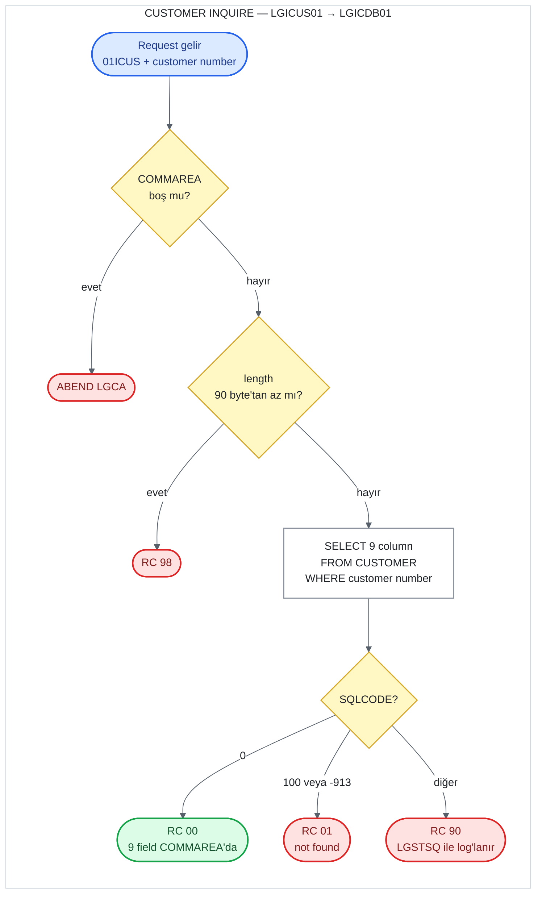

# UC-02 · Customer Inquire

Customer number'ı verilen bir customer'ın bilgilerini Db2'deki `CUSTOMER` table'ından
okuyan operasyon. Hiçbir yere yazmaz; VSAM dosyasını da okumaz. Bu belge, C# kodunu
yazacak kişi için eski sistemin davranışını satır satır tarif eder. Satır numaraları
`base/src` altındaki dosyalara aittir ve linkler ilgili satırı açar.

Programların hangi sırayla call edildiğini ve COMMAREA'nın nasıl taşındığını adım adım
gösteren sequence diagram:
[docs/diagrams/sequence-customer-inquire.md](../../docs/diagrams/sequence-customer-inquire.md).

## Özet

| | |
|---|---|
| **Request ID** (`CA-REQUEST-ID`) | `01ICUS` — screen bunu gönderir ama call chain'deki hiçbir program kontrol etmez |
| **Entry program** | `LGICUS01` (business layer) |
| **Call chain** | `LGICUS01` → `LGICDB01` |
| **Okunduğu yer** | Db2 `CUSTOMER` table (write yok) |
| **Output** | Customer'ın 9 field'ı COMMAREA'da, `CA-RETURN-CODE = '00'` |
| **Olası return code'lar** | `00`, `01`, `90`, `98` (ve ABEND `LGCA`) |

## Flow

## Input (COMMAREA)

Screen (`LGTESTC1`, menu 1) sadece iki field doldurup `LGICUS01`'i call eder
([lgtestc1.cbl:86-92](../../base/src/lgtestc1.cbl#L86-L92)). Field tanımları
[lgcmarea.cpy](../../base/src/lgcmarea.cpy) içinde.

| Field | Type | Gelen value | Kullanım |
|---|---|---|---|
| `CA-REQUEST-ID` | `X(6)` | `'01ICUS'` | Kontrol edilmiyor |
| `CA-CUSTOMER-NUM` | `9(10)` | screen'de girilen number | `WHERE CUSTOMERNUMBER = ...` koşulu |

Diğer bütün field'lar input olarak kullanılmaz; output için doldurulur.

## Adım adım

| # | Program | Ne yapıyor | Kaynak |
|---:|---|---|---|
| 1 | `LGICUS01` | COMMAREA hiç gelmediyse (`EIBCALEN = 0`) error log'a yazar ve `LGCA` koduyla ABEND eder. | [lgicus01.cbl:87-91](../../base/src/lgicus01.cbl#L87-L91) |
| 2 | `LGICUS01` | `CA-RETURN-CODE = '00'`, `CA-NUM-POLICIES = 000` yapar. | [lgicus01.cbl:93-94](../../base/src/lgicus01.cbl#L93-L94) |
| 3 | `LGICUS01` | Gereken minimum length = 18 + `WS-CUSTOMER-LEN` 72 = **90 byte**. Daha kısaysa `'98'` ile return eder. | [lgicus01.cbl:102-107](../../base/src/lgicus01.cbl#L102-L107), [lgpolicy.cpy:17](../../base/src/lgpolicy.cpy#L17) |
| 4 | `LGICUS01` | `LGICDB01`'i aynı COMMAREA ile `LINK` eder (32.500 byte), return'de hiçbir şeyi değiştirmeden caller'a return eder. Business layer'ın bu operasyonda başka rule'u yok. | [lgicus01.cbl:109](../../base/src/lgicus01.cbl#L109), [120-125](../../base/src/lgicus01.cbl#L120-L125) |
| 5 | `LGICDB01` | 1-3. adımdaki kontrollerin aynısını tekrarlar (ABEND `LGCA`, `'00'`, 90 byte → `'98'`). | [lgicdb01.cbl:119-143](../../base/src/lgicdb01.cbl#L119-L143) |
| 6 | `LGICDB01` | `CA-CUSTOMER-NUM`'u Db2 integer'ına (`DB2-CUSTOMERNUMBER-INT`) çevirir. | [lgicdb01.cbl:146](../../base/src/lgicdb01.cbl#L146) |
| 7 | `LGICDB01` | `SELECT FIRSTNAME, LASTNAME, DATEOFBIRTH, HOUSENAME, HOUSENUMBER, POSTCODE, PHONEMOBILE, PHONEHOME, EMAILADDRESS FROM CUSTOMER WHERE CUSTOMERNUMBER = ...` çalıştırır; result doğrudan COMMAREA field'larına yazılır. | [lgicdb01.cbl:169-190](../../base/src/lgicdb01.cbl#L169-L190) |
| 8 | `LGICDB01` | `SQLCODE`'a göre return code'u belirler (aşağıdaki table) ve return eder. | [lgicdb01.cbl:192-203](../../base/src/lgicdb01.cbl#L192-L203) |

## Output (COMMAREA)

Başarılı (`'00'`) query'den sonra dolu gelen field'lar:

| Field | Type | Kaynak column |
|---|---|---|
| `CA-FIRST-NAME` | `X(10)` | `FIRSTNAME` |
| `CA-LAST-NAME` | `X(20)` | `LASTNAME` |
| `CA-DOB` | `X(10)` | `DATEOFBIRTH` (Db2 `DATE`, string olarak döner) |
| `CA-HOUSE-NAME` | `X(20)` | `HOUSENAME` |
| `CA-HOUSE-NUM` | `X(4)` | `HOUSENUMBER` |
| `CA-POSTCODE` | `X(8)` | `POSTCODE` |
| `CA-PHONE-MOBILE` | `X(20)` | `PHONEMOBILE` |
| `CA-PHONE-HOME` | `X(20)` | `PHONEHOME` |
| `CA-EMAIL-ADDRESS` | `X(100)` | `EMAILADDRESS` |
| `CA-NUM-POLICIES` | `9(3)` | hesaplanmaz, her zaman `000` |
| `CA-RETURN-CODE` | `9(2)` | `00` |

## Return code'lar

| Code | Koşul | Nerede set ediliyor | Caller ne görür |
|---|---|---|---|
| `00` | Customer bulundu (`SQLCODE = 0`) | [lgicdb01.cbl:193-194](../../base/src/lgicdb01.cbl#L193-L194) | 9 field dolu |
| `01` | Customer yok (`SQLCODE = 100`) **veya** Db2 deadlock/timeout (`SQLCODE = -913`) | [lgicdb01.cbl:195-198](../../base/src/lgicdb01.cbl#L195-L198) | Screen "No data was returned." gösterir |
| `90` | Diğer her `SQLCODE` | [lgicdb01.cbl:199-202](../../base/src/lgicdb01.cbl#L199-L202) | Error `LGSTSQ` ile `CSMT`/`GENAERRS` queue'larına yazılır; screen aynı "No data was returned." mesajını gösterir |
| `98` | COMMAREA 90 byte'tan kısa | [lgicus01.cbl:104-107](../../base/src/lgicus01.cbl#L104-L107), [lgicdb01.cbl:140-143](../../base/src/lgicdb01.cbl#L140-L143) | Screen her zaman 32.500 byte gönderdiği için pratikte oluşmaz |
| — | COMMAREA hiç yok | [lgicus01.cbl:87-91](../../base/src/lgicus01.cbl#L87-L91) | ABEND `LGCA` |

Screen tarafı: `CA-RETURN-CODE > 0` ise code'un ne olduğuna bakmadan "No data was returned."
gösterir; yani screen'de `01` ile `90` ayırt edilmez
([lgtestc1.cbl:94-96](../../base/src/lgtestc1.cbl#L94-L96),
[267-269](../../base/src/lgtestc1.cbl#L267-L269)).

## Okunan data

**Db2 `CUSTOMER` table** ([db2cre.jcl:110-124](../../base/cntl/db2cre.jcl#L110-L124)) —
key `CUSTOMERNUMBER`; okunan 9 column yukarıdaki output table'ında. `KSDSCUST` VSAM
dosyası bu operasyonda hiç okunmaz; customer bilgisinin tek kaynağı Db2.

## C#'a taşırken dikkat edilecek davranışlar

1. **`-913` "not found" sayılıyor.** Db2 deadlock/timeout error'u, customer yok gibi
   `'01'` döndürülüyor ve log'a yazılmıyor. Yeni sistemde bu davranışın korunup
   korunmayacağına karar verilmeli.
2. **Not found olunca field'lar temizlenmiyor.** `SELECT ... INTO` row bulamazsa
   COMMAREA'daki field'lara dokunmaz; içlerinde caller'ın gönderdiği ne varsa kalır.
   Sadece return code güvenilir.
3. **`NULL` column'lar error verir.** Query'de indicator variable yok. Table'daki
   column'lar `NULL` olabildiği halde ([db2cre.jcl:113-121](../../base/cntl/db2cre.jcl#L113-L121)),
   bu operasyonla eklenen customer'lar her column'u doldurduğu için pratikte sorun
   çıkmaz; ama dışarıdan `NULL` yazılmış bir row okunursa Db2 error döner ve sonuç
   `'90'` olur.
4. **`CA-REQUEST-ID` kontrol edilmiyor.** Ne `LGICUS01` ne `LGICDB01` request ID'yi
   denetliyor.
5. **`CA-NUM-POLICIES` hesaplanmıyor.** Field'ın adı customer'ın policy sayısını
   çağrıştırsa da bu operasyon onu her zaman `000` yapıyor.
6. **Error log'daki etiket yanlış.** `LGICDB01`'in error mesajı kendini `LGICUS01`
   olarak etiketliyor ([lgicdb01.cbl:44](../../base/src/lgicdb01.cbl#L44)); queue'larda
   `LGICUS01` görünen Db2 error'ları aslında `LGICDB01`'den geliyor.
