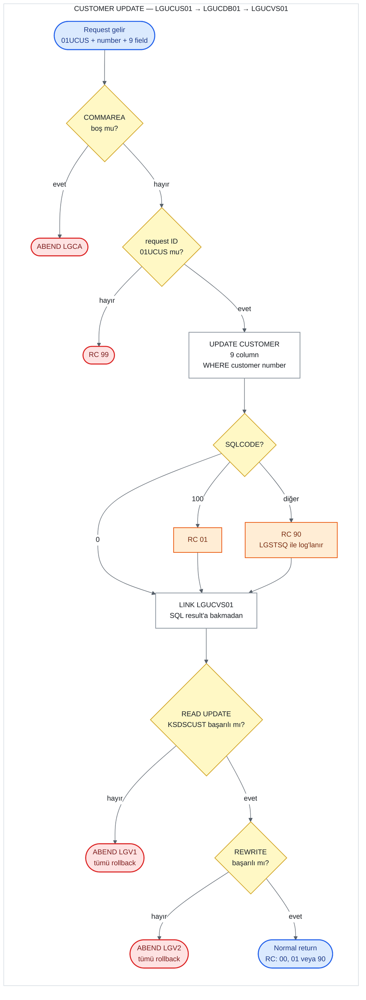

# UC-03 · Customer Update

Var olan bir customer'ın bilgilerini Db2'deki `CUSTOMER` table'ında ve `KSDSCUST` VSAM
dosyasında güncelleyen operasyon. Bu belge, C# kodunu yazacak kişi için eski sistemin
davranışını satır satır tarif eder. Satır numaraları `base/src` altındaki dosyalara aittir
ve linkler ilgili satırı açar.

## Özet

| | |
|---|---|
| **Request ID** (`CA-REQUEST-ID`) | `01UCUS` — üç customer operasyonu içinde request ID'yi **kontrol eden tek operasyon** |
| **Entry program** | `LGUCUS01` (business layer) |
| **Call chain** | `LGUCUS01` → `LGUCDB01` → `LGUCVS01` |
| **Yazıldığı yerler** | Db2 `CUSTOMER` table (`UPDATE`), VSAM `KSDSCUST` (`READ UPDATE` + `REWRITE`) |
| **Output** | `CA-RETURN-CODE = '00'`; başka data dönmez |
| **Olası return code'lar** | `00`, `01`, `90`, `99` (ve ABEND `LGCA`, `LGV1`, `LGV2`) |

Screen'de Update iki adımlıdır: menu 4 önce **Customer Inquire**'ı
([02-customer-inquire.md](02-customer-inquire.md)) call edip mevcut bilgiyi screen'e
getirir, kullanıcı düzenleyip Enter'a basınca bu operasyonu call eder
([lgtestc1.cbl:148-193](../../base/src/lgtestc1.cbl#L148-L193)). Bu belge ikinci adımı
anlatır.

## Flow

Turuncu kutular return code'un set edildiği ama flow'un **durmadığı** yerlerdir: `UPDATE`
başarısız olsa da flow VSAM adımına devam eder.

## Input (COMMAREA)

Screen, ikinci adımda aşağıdaki field'ları doldurup `LGUCUS01`'i call eder
([lgtestc1.cbl:176-193](../../base/src/lgtestc1.cbl#L176-L193)). Field tanımları
[lgcmarea.cpy](../../base/src/lgcmarea.cpy) içinde.

| Field | Type | Gelen value | Kullanım |
|---|---|---|---|
| `CA-REQUEST-ID` | `X(6)` | `'01UCUS'` | `LGUCUS01` kontrol eder; farklıysa `'99'` |
| `CA-CUSTOMER-NUM` | `9(10)` | screen'de o anda yazan number | `WHERE` koşulu ve VSAM key |
| `CA-FIRST-NAME` | `X(10)` | screen'den | `CUSTOMER.FIRSTNAME` |
| `CA-LAST-NAME` | `X(20)` | screen'den | `CUSTOMER.LASTNAME` |
| `CA-DOB` | `X(10)` | screen'den | `CUSTOMER.DATEOFBIRTH` (Db2'de `DATE` type) |
| `CA-HOUSE-NAME` | `X(20)` | screen'den | `CUSTOMER.HOUSENAME` |
| `CA-HOUSE-NUM` | `X(4)` | screen'den | `CUSTOMER.HOUSENUMBER` |
| `CA-POSTCODE` | `X(8)` | screen'den, **uppercase'e çevrilmiş** | `CUSTOMER.POSTCODE` |
| `CA-PHONE-MOBILE` | `X(20)` | screen'den | `CUSTOMER.PHONEMOBILE` |
| `CA-PHONE-HOME` | `X(20)` | screen'den | `CUSTOMER.PHONEHOME` |
| `CA-EMAIL-ADDRESS` | `X(100)` | screen'den | `CUSTOMER.EMAILADDRESS` |

Screen, Add'deki gibi `X'00'` byte'larını space'e ve postcode'u uppercase'e çevirir
([lgtestc1.cbl:187-189](../../base/src/lgtestc1.cbl#L187-L189)). Customer number, ilk
adımda sorgulanan number değil, screen'de o anda yazan number'dır; kullanıcı iki adım
arasında number'ı değiştirirse başka bir customer güncellenir.

## Adım adım

| # | Program | Ne yapıyor | Kaynak |
|---:|---|---|---|
| 1 | `LGUCUS01` | COMMAREA hiç gelmediyse (`EIBCALEN = 0`) error log'a yazar ve `LGCA` koduyla ABEND eder. | [lgucus01.cbl:99-103](../../base/src/lgucus01.cbl#L99-L103) |
| 2 | `LGUCUS01` | `CA-RETURN-CODE = '00'`, `CA-NUM-POLICIES = 000` yapar. | [lgucus01.cbl:105-106](../../base/src/lgucus01.cbl#L105-L106) |
| 3 | `LGUCUS01` | `CA-REQUEST-ID` `'01UCUS'` değilse `'99'` yazar ve return eder. | [lgucus01.cbl:110-113](../../base/src/lgucus01.cbl#L110-L113) |
| 4 | `LGUCUS01` | `LGUCDB01`'i aynı COMMAREA ile `LINK` eder (32.500 byte), return'de hiçbir şeyi kontrol etmeden caller'a return eder. **Length check yok** (Add ve Inquire'ın aksine). | [lgucus01.cbl:116-120](../../base/src/lgucus01.cbl#L116-L120), [126-131](../../base/src/lgucus01.cbl#L126-L131) |
| 5 | `LGUCDB01` | COMMAREA yoksa ABEND `LGCA`; `CA-RETURN-CODE = '00'`. Length check bu programda da yok. | [lgucdb01.cbl:117-124](../../base/src/lgucdb01.cbl#L117-L124) |
| 6 | `LGUCDB01` | `CA-CUSTOMER-NUM`'u Db2 integer'ına çevirir. | [lgucdb01.cbl:129](../../base/src/lgucdb01.cbl#L129) |
| 7 | `LGUCDB01` | `UPDATE CUSTOMER SET` 9 column `WHERE CUSTOMERNUMBER = ...` çalıştırır. `SQLCODE = 100` ise `'01'`, başka bir error ise `'90'` yazar ve error'u log'a yazar; **return etmez, devam eder**. | [lgucdb01.cbl:152-181](../../base/src/lgucdb01.cbl#L152-L181) |
| 8 | `LGUCDB01` → `LGUCVS01` | 7. adımın result'ına bakmadan, COMMAREA'yı `LENGTH(225)` ile `LGUCVS01`'e verir. | [lgucdb01.cbl:134-139](../../base/src/lgucdb01.cbl#L134-L139) |
| 9 | `LGUCVS01` | `KSDSCUST`'ten customer record'unu update amaçlı okur (`READ UPDATE`, record'u lock'lar). Başarısızsa `'81'` yazar ve `LGV1` ile ABEND eder. | [lgucvs01.cbl:69-83](../../base/src/lgucvs01.cbl#L69-L83) |
| 10 | `LGUCVS01` | Record'u COMMAREA'daki 225 byte ile tamamen yeniden yazar (`REWRITE`). Başarısızsa `'82'` yazar ve `LGV2` ile ABEND eder. | [lgucvs01.cbl:85-96](../../base/src/lgucvs01.cbl#L85-L96) |
| 11 | `LGUCDB01` | Caller'a return eder; `CA-RETURN-CODE` 7. adımda ne olduysa o (`00`, `01` veya `90`). | [lgucdb01.cbl:142-143](../../base/src/lgucdb01.cbl#L142-L143) |

## Return code'lar

| Code | Koşul | Nerede set ediliyor | Caller ne görür |
|---|---|---|---|
| `00` | Db2 `UPDATE` ve VSAM `REWRITE` başarılı | [lgucus01.cbl:105](../../base/src/lgucus01.cbl#L105), [lgucdb01.cbl:124](../../base/src/lgucdb01.cbl#L124) | Screen "Customer details updated" gösterir |
| `99` | `CA-REQUEST-ID` `'01UCUS'` değil | [lgucus01.cbl:110-113](../../base/src/lgucus01.cbl#L110-L113) | Hiçbir yere yazılmaz. Screen her zaman `'01UCUS'` gönderdiği için pratikte oluşmaz. |
| `01` | `UPDATE` hiçbir row bulamadı (`SQLCODE = 100`) | [lgucdb01.cbl:173-174](../../base/src/lgucdb01.cbl#L173-L174) | **Çoğu zaman görmez** — aşağıdaki "dikkat" madde 2'ye bakın |
| `90` | `UPDATE` başka bir error ile başarısız | [lgucdb01.cbl:175-178](../../base/src/lgucdb01.cbl#L175-L178) | `90` görür, ama VSAM record'u yine de güncellenmiştir (madde 1) |
| `81` | `KSDSCUST`'te `READ UPDATE` başarısız (ör. record yok) | [lgucvs01.cbl:77-83](../../base/src/lgucvs01.cbl#L77-L83) | **Görmez.** Hemen ardından ABEND `LGV1`; transaction (Db2 `UPDATE` dahil) rollback edilir |
| `82` | `KSDSCUST`'te `REWRITE` başarısız | [lgucvs01.cbl:90-96](../../base/src/lgucvs01.cbl#L90-L96) | **Görmez.** Hemen ardından ABEND `LGV2`; transaction rollback edilir |
| — | COMMAREA hiç yok | [lgucus01.cbl:99-103](../../base/src/lgucus01.cbl#L99-L103) | ABEND `LGCA` |

Screen tarafı: `CA-RETURN-CODE > 0` ise "Error Updating Customer" gösterir. Add'den farklı
olarak burada **`SYNCPOINT ROLLBACK` yapılmaz**
([lgtestc1.cbl:195-197](../../base/src/lgtestc1.cbl#L195-L197),
[259-261](../../base/src/lgtestc1.cbl#L259-L261)); task normal biter ve yapılan write'lar
commit edilir.

## Yazılan data

**Db2 `CUSTOMER` table** ([db2cre.jcl:110-124](../../base/cntl/db2cre.jcl#L110-L124)) —
input table'ındaki 9 column'un hepsi gelen value'larla değiştirilir; `CUSTOMERNUMBER`
değişmez. Partial update yok: boş gelen field, table'daki value'yu space ile ezer.

**VSAM `KSDSCUST`** ([adef121.jcl:15-27](../../base/cntl/adef121.jcl#L15-L27)) — 225
byte'lık record, COMMAREA'da `CA-CUSTOMER-NUM`'dan başlayan 225 byte ile tamamen
değiştirilir: number (10) + customer field'ları (212) + `CA-NUM-POLICIES` (3, her zaman
`000`). Dosya `LOG(UNDO)` ile tanımlı; ABEND olursa bu write da rollback edilir.

## C#'a taşırken dikkat edilecek davranışlar

1. **Db2 error'unda bile VSAM güncelleniyor.** `UPDATE` `'90'` ile başarısız olunca
   `LGUCDB01` durmuyor; `LGUCVS01` VSAM record'unu yeni value'larla yeniden yazıyor
   ([lgucdb01.cbl:134-139](../../base/src/lgucdb01.cbl#L134-L139)). Screen de update'te
   rollback yapmadığı için sonuç: Db2'de eski data, VSAM'da yeni data. Bu, eski sistemin
   bir bug'ı; yeni sistemde tek database olacağı için bu inconsistency taşınmamalı.
2. **Not found (`'01'`) pratikte caller'a ulaşmıyor.** Customer Db2'de yoksa normalde
   VSAM'da da yoktur; bu durumda 9. adımdaki `READ UPDATE` başarısız olur ve task `LGV1`
   ile ABEND eder. `'01'` yalnızca customer VSAM'da olup Db2'de olmadığında (iki kaynak
   inconsistent ise) caller'a döner; o durumda da VSAM record'u yeniden yazılır. Yeni
   sistemde "customer yok" durumu net bir sonuç olarak dönmeli (mapping kararı API
   tasarımına ait).
3. **Optimistic locking yok.** Policy update'in aksine customer update'te timestamp ya da
   version kontrolü yok; aynı customer'ı iki kişi güncellerse last write wins.
4. **Length check yok.** Add ve Inquire'daki 90 byte kontrolü burada hiçbir programda
   yapılmıyor (`LGUCUS01`'de tanımlı `WS-CA-HEADER-LEN` hiç kullanılmıyor,
   [lgucus01.cbl:57](../../base/src/lgucus01.cbl#L57)).
5. **Input validation yok.** Tek örtük kontrol Db2'nin `DATE` type'ı: `CA-DOB` geçerli bir
   date değilse `UPDATE` başarısız olur → `'90'` (ve madde 1'deki inconsistency).
6. **`CUSTOMER_SECURE` table'ına dokunulmuyor.** Update, password table'ını değiştirmez.
